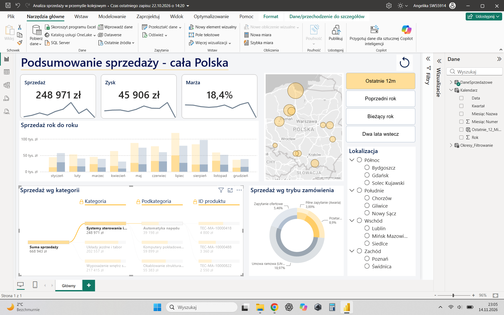
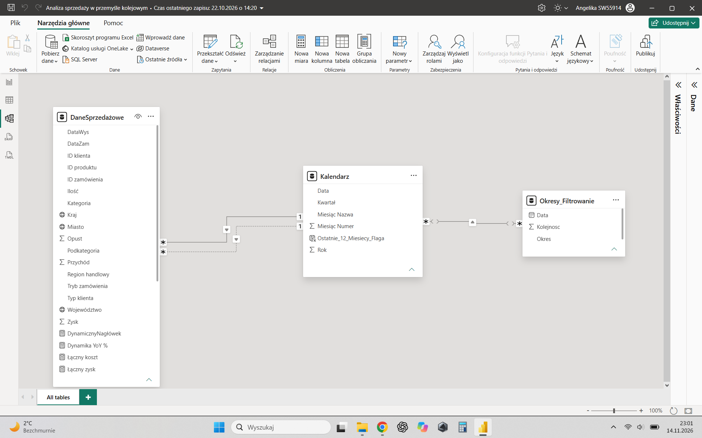

# Railway Industry Sales Analysis (Power BI)

## Project Overview
An interactive Business Intelligence dashboard analyzing sales performance, profitability, and order structures in the Polish railway sector (based on **9,994 transaction records**). The report enables dynamic exploration of revenue across regions, cities, product categories, and procurement modes.

## Interactive Demo

https://github.com/user-attachments/assets/cff11716-0a4e-48c2-9e3e-cffdd9e6215e


## Key Business Insights (Last 12 Months View)
* **Overall Performance:** Total revenue reached **668,943 PLN** with a net profit of **84,685 PLN** (**12.7% profit margin**).
* **Top Product Category:** **Control & IT Systems** (*Systemy sterowania i IT*) is the leading revenue driver (**248,971 PLN**), followed closely by **Interior Equipment** (*Wyposażenie wnętrz składów* – **217,415 PLN**) and **Running Gear & Rolling Stock** (*Układy jezdne i tabor* – **202,557 PLN**).
* **Procurement Structure:** Over half of the sales (**54.26%**) are generated through **Framework Maintenance Agreements** (*Umowa ramowa – Utrzymanie*), followed by Tenders (*Przetarg* – **19.28%**) and RFQs (*Zapytanie ofertowe* – **19.25%**). Urgent breakdown requests (*Pilne zapytanie – Awaria*) account for **7.21%**.
* **Seasonality:** Sales peak significantly during the summer months (**July** and **August**), showing strong mid-year demand.

## Data Model & Technical Highlights
* **Data Model:** Structured around the `DaneSprzedażowe` fact table (9,994 rows) connected to a custom `Kalendarz` (Date) table and a calculated bridge table (`Okresy_Filtrowanie`) using a bi-directional many-to-many relationship for custom relative date filtering.
* **Custom Time-Period Slicer (ChicletSlicer + DAX):** Built a dynamic period selector (*Last 12M*, *Previous Year*, *Current Year*, *2 Years Ago*) using a calculated DAX table (`UNION` + `CALENDAR` + `EDATE`).
* **Dynamic UX & Visuals:**
  * **Dynamic Report Title (`DynamicznyNagłówek`):** Automatically updates the header based on the selected region or city (e.g., *"Podsumowanie sprzedaży - cała Polska"*).
  * **Decomposition Tree:** Interactive drill-down from *Category* $\rightarrow$ *Subcategory* $\rightarrow$ *Product ID*.
  * **Map & Hierarchical Slicer:** Geographic breakdown across 4 sales regions (*Północ, Południe, Wschód, Zachód*) and key Polish cities (e.g., Bydgoszcz, Gdańsk, Warszawa, Poznań, Wrocław, Kraków).
  * **Reset Filters Button:** Custom bookmark action to restore the default report view with one click.

### Featured DAX Measures

#### 1. Dynamic Report Header (`DynamicznyNagłówek`)
Automatically adjusts the dashboard title depending on whether a specific city, sales region, or the entire country is selected:
```dax
DynamicznyNagłówek = 
VAR WybranyRegion = SELECTEDVALUE('DaneSprzedażowe'[Region Handlowy], "cała Polska")
VAR WybraneMiastaTekst = CONCATENATEX(VALUES('DaneSprzedażowe'[Miasto]), [Miasto], " i ")
RETURN
    IF (
        ISFILTERED('DaneSprzedażowe'[Miasto]),
        "Podsumowanie sprzedaży - " & WybraneMiastaTekst,
        "Podsumowanie sprzedaży - " & WybranyRegion
    )
```

#### 2. Dynamic Period Filter Table (`Okresy_Filtrowanie`)
Generates relative date ranges (*Last 12M*, *Previous Year*, *Current Year*, *2 Years Ago*) dynamically anchored to `TODAY()`:
```dax
Okresy_Filtrowanie = 
VAR Dzis = TODAY()
VAR PierwszyDzienMiesiaca = DATE(YEAR(Dzis), MONTH(Dzis), 1)
VAR Poczatek12M = EDATE(PierwszyDzienMiesiaca, -12)
VAR Koniec12M = PierwszyDzienMiesiaca - 1

-- Generujemy mapowanie każdego okresu na konkretne daty z kalendarza
VAR Ostatnie12M = 
    ADDCOLUMNS(
        CALENDAR(Poczatek12M, Koniec12M),
        "NazwaOkresu", "Ostatnie 12m",
        "Kolejnosc", 1
    )
VAR RokMinus1 = 
    ADDCOLUMNS(
        CALENDAR(DATE(YEAR(Dzis)-1,1,1), DATE(YEAR(Dzis)-1,12,31)),
        "NazwaOkresu", "Poprzedni rok",
        "Kolejnosc", 2
    )
VAR RokObecny = 
    ADDCOLUMNS(
        CALENDAR(DATE(YEAR(Dzis),1,1), DATE(YEAR(Dzis),12,31)),
        "NazwaOkresu", "Bieżący rok",
        "Kolejnosc", 3
    )
VAR RokMinus2 = 
    ADDCOLUMNS(
        CALENDAR(DATE(YEAR(Dzis)-2,1,1), DATE(YEAR(Dzis)-2,12,31)),
        "NazwaOkresu", "Dwa lata wstecz",
        "Kolejnosc", 4
    )

RETURN
UNION(Ostatnie12M, RokMinus1, RokObecny, RokMinus2)
```

## Screenshots
### Main Dashboard View


### Data Model & Relationships


## How to Run Locally
1. Click on the `.pbix` file in the repository file list above and select **Download raw file**.
2. Open the file in **Power BI Desktop**.

---

## Contact & Author
* **LinkedIn:** [linkedin.com/in/angelika-adamczewska](https://linkedin.com)
* **GitHub:** [github.com/Angelama7](https://github.com)
